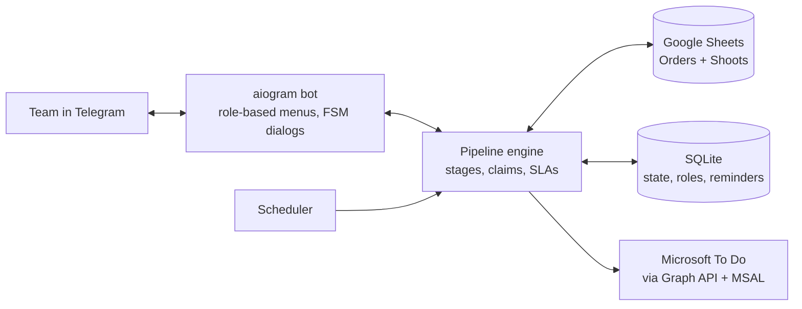

# Studio CRM Bot

**A Telegram-first CRM for a photo studio: Google Sheets as the database, Telegram for the team workflow, Microsoft To Do for tasks. Nobody on the team has to open a spreadsheet.**


> Built for the graduation photo album team I work in; the four of us run all orders through it. Each order goes through 10 stages and passes between sales, schedulers, photographers, retouchers, designers and print.

---

## The problem

Orders lived in a shared spreadsheet. Nobody knew whose turn it was, photographers were assigned in group chats, and deadlines slipped quietly.

## What it does

- **Order pipeline in chat**: Lead → Agreed → Dates set → Looking for photographer → Shoot → Retouching → Layout → Client approval → Print → Delivered. Each stage has an owner role and a single "next step" button.
- **Automatic hand-offs**: when a stage closes, the next person is notified right away, the old To Do task is completed and a new one is created with a due date.
- **Photographer marketplace**: every shoot is broadcast to photographers with a **"✋ Take it" claim button** (first tap wins, with a race-safe claim). "🚫 Decline" puts it back in the pool.
- **Multiple shoots per order**, each with its own date, time and location. Natural-language dates work: "tomorrow 15:30", "12 October at 10:00", "Fri 11:00".
- **Material chain**: closing a stage asks for a link (raw photos → retouched → layout), stores it in the sheet and forwards it to the next stage.
- **Reminders and SLAs**: per-stage deadlines, an "overdue by N days" marker, an evening schedule for tomorrow, a weekly plan on Sundays, a 2-hour pre-shoot reminder, and a reminder frequency each user picks.
- **Role-based menus**: each user sees only the buttons and `/` commands their role allows. The owner can do anything: roll back stages, reassign, delete orders.
- **Self-hosting ops from Telegram**: status, logs, restart and "update from GitHub", with no SSH.

## Architecture



## Tech stack

`Python 3.11` · `aiogram 3` (FSM, inline keyboards) · `gspread` + `google-auth` (service account) · `Microsoft Graph` + `MSAL` (device-code OAuth) · `aiosqlite` · `pydantic` · `httpx` · `typer` + `rich` (setup CLI) · `Docker` · `pytest` (364 tests)

## Engineering highlights

- The spreadsheet stays the **source of truth**. Rows deleted by hand are detected and cleaned up, and new columns are added by the bot itself.
- Two-way consistency between Sheets, To Do and Telegram, with idempotent task create/close.
- Every dialog can be cancelled, and stale callbacks are handled gracefully.
- Setup wizard (`python -m crmlumi setup` / `todo-setup`) and an `install-service` command turn a laptop into a 24/7 host. Docker works too.

## Quick start

```bash
pip install -e ".[dev]"
python -m crmlumi setup        # Google Sheet + Telegram token
python -m crmlumi todo-setup   # optional: Microsoft To Do lists
python -m crmlumi run
pytest
```

Docker:

```bash
docker compose run --rm crmlumi python -m crmlumi setup
docker compose up -d
```

---

📄 Detailed user documentation (Russian): [README.ru.md](README.ru.md) · Deployment guide: [docs/deployment-mac.md](docs/deployment-mac.md)

💼 Want your business process moved from spreadsheets into a Telegram bot? **[Hire me on Upwork](https://www.upwork.com/freelancers/~01b79ffa28442df3f8)**
